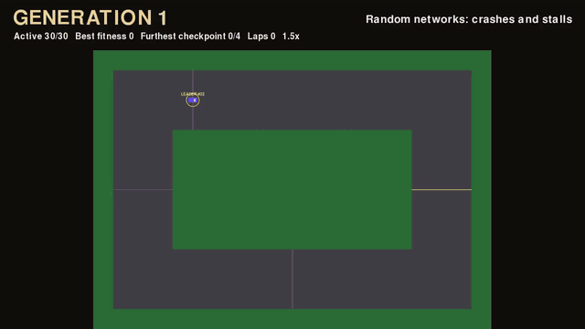
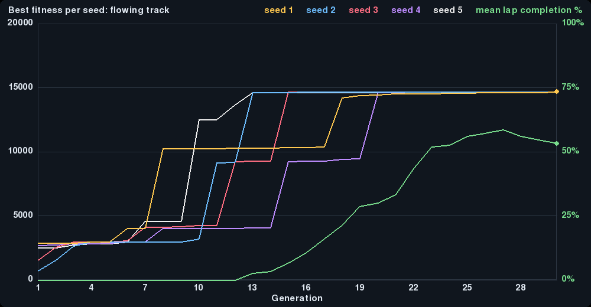
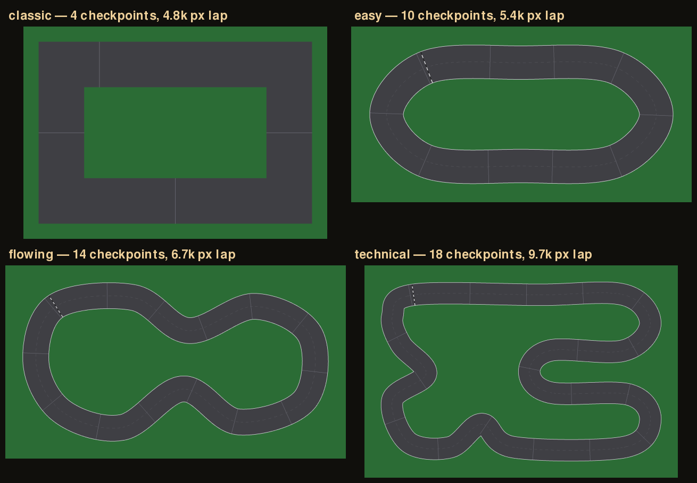
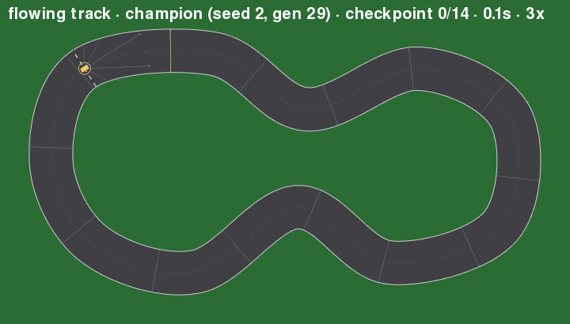

# AI Racer

A 2D top-down racing game in Python and Pygame, in which neural-network drivers learn to race through **neuroevolution**. It has four circuits, from a simple rectangle to a hairpin-heavy technical track, and you can drive them yourself.



*Generation 1: random networks crash or stall. By generation 13 they take the first corner, and at generation 16 the first drivers complete a lap. By generation 19, 20 of the 30 finish. [Full-quality MP4](docs/demo.mp4).*

**Portfolio write-up:** [joelmorrison121-cpu.github.io/ai-racing.html](https://joelmorrison121-cpu.github.io/ai-racing.html) · **Releases:** `v1.0` (classic track) · `v2.0` (tracks, experiments)

## Results at a glance

Five independent training runs (seeds 1–5) on the **flowing** track, 30 drivers × 30 generations, then each champion tested on every track ([full results](docs/results/flowing-5-seeds.md)):

| | |
| --- | --- |
| Seeds that learned a full lap | **5 / 5** |
| First lap reached at generation | **15.8 ± 3.1** |
| Best lap time | **15.7 ± 0.3 s** |
| Unseen **easy** oval | 5 / 5 champions complete a lap |
| Unseen **classic** rectangle (90° corners) | 2 / 5 complete a lap |
| Unseen **technical** track (hairpins) | 0 / 5; they get 47% of the way round on average |

The drivers learn behaviour that **transfers to similar, smoother tracks** but not yet to tight hairpins they never saw. That's the next thing to investigate.



---

## Installation

You need Python 3.10 or newer (tested on 3.12 and 3.13) and a desktop display.

```bash
git clone https://github.com/joelmorrison121-cpu/AI_racer.git
cd AI_racer
python -m venv .venv
# Windows PowerShell:  .venv\Scripts\Activate.ps1
# macOS / Linux:       source .venv/bin/activate
python -m pip install -r requirements.txt
```

On Windows, you can use `py` in place of `python`. The only dependency is `pygame-ce`.

## Manual driving and champion playback

```bash
python main.py                                              # classic track, champion.json
python main.py --track flowing --champion champions/flowing.json
python main.py --track technical                            # drive it yourself
```

| Key | Action |
| --- | --- |
| W / ↑ | Accelerate |
| S / ↓ | Brake |
| A / ← and D / → | Steer |
| Tab | Switch between **manual driving** and the **saved champion AI** |
| R | Reset the current attempt |
| T | Print the current sensor inputs and the AI's decision to the terminal |

The game starts in manual mode (`--ai` starts in AI mode). Press **Tab** to watch the champion drive. A crash resets the attempt but keeps your best lap time.

## Tracks



| Track | Checkpoints | Time limit | Character |
| --- | --- | --- | --- |
| `classic` | 4 | 30 s | The original v1.0 rectangle: four straights and four 90° corners |
| `easy` | 10 | 40 s | A wide oval with gentle, constant-radius bends |
| `flowing` | 14 | 50 s | Sweeping S-bends and diagonals that reward smooth lines |
| `technical` | 18 | 60 s | Two hairpins, a chicane and a tight inner loop |

Tracks other than classic are defined in `track.py` as a **closed centre-line path plus a road width**. The path is smoothed with a Catmull-Rom spline, and the collision mask, picture and checkpoints are all generated from it. Checkpoints are line segments **perpendicular to the path**, so they work at any angle. To add a track, add a list of control points to `TRACK_DEFINITIONS`.

## Live training

```bash
python live_train.py
```

This starts a new population of 30 random drivers and evolves them while you watch.

| Key | Action |
| --- | --- |
| Space | Pause / resume |
| 1 / 2 / 3 | Target playback speed 1× / 2× / 4× |
| F | Toggle the whole-track overview / following the leader |
| S | Show the leader's sensor rays |
| G | Show / hide the training progress graph |
| Enter | Skip to the next generation once the current one has finished |
| Esc | Quit |

To train faster without the viewer, run `python train.py`. It uses exactly the same rules. Both trainers take the same options:

```bash
python train.py --generations 50            # run longer without editing code
python train.py --track flowing --seed 7    # another track / experiment
python live_train.py --resume training_runs/<run> --generations 60   # continue a run
```

| Option | Default | Meaning |
| --- | --- | --- |
| `--generations N` | 20 | Generation limit. With `--resume`, a higher number extends a finished run |
| `--population N` | 30 | Drivers per generation (minimum 8) |
| `--seed N` | 42 | Random seed; the same seed and settings give the same experiment |
| `--track NAME` | classic | `classic`, `easy`, `flowing` or `technical` |
| `--resume FOLDER` | none | Continue a run from its `checkpoint.json` (it uses that run's track) |
| `--legacy-fitness` | off | v1.0 scoring: straight-line progress and no lap-time bonus |

Each run writes to its own `training_runs/<timestamp>/` folder, updated after every generation:
- `champion.json`, the best network so far
- `history.json`, with best and average fitness, outcomes, lap-completion rate and best lap for each generation
- `progress.png`, a graph of `history.json`. Press **G** in the live viewer to see it while training
- `checkpoint.json`, which holds the whole population, fitness scores, generation number and the random generator's exact state. `--resume` uses it to carry on **exactly** as if the run had never stopped. If you quit mid-generation, that generation restarts.

Training never overwrites the root `champion.json`. To play a new champion, run `python main.py --track <track> --champion training_runs/<run>/champion.json` and press Tab.

## Experiments: several seeds and unseen tracks

One lucky run proves little, so `experiment.py` repeats the same settings across several random seeds, running in parallel. It then tests every champion on every track, including the ones it never trained on:

```bash
python experiment.py --track flowing --seeds 1 2 3 4 5 --generations 30
python evaluate_tracks.py --champion champions/flowing.json     # one champion, all tracks
```

The experiment writes `summary.md` (tables), `summary.json` and `comparison.png` into `experiments/<time>-<track>/`.

## How it learns

This is **neuroevolution**, not backpropagation or reinforcement-learning gradient updates.

1. **Observe.** Each car casts 7 distance rays, at −90° to +90°. It also senses its forward and sideways speed and the direction to its next checkpoint, giving **11 inputs**.
2. **Act.** A small feed-forward network (11 → 8 → 3, tanh) outputs steering, accelerator and brake.
3. **Evaluate.** A car scores 1000 fitness for each checkpoint passed in order, plus 0–999 partial credit for its **progress along the track's centre line** towards the next one. Following the route through a bend counts; cutting towards a checkpoint across the grass doesn't. A **completed lap** scores `checkpoints × 1000` plus up to **1000 bonus for speed**, so drivers that can already finish keep getting faster. An attempt ends on a crash, after 8 s without progress, at the track's time limit, or after one lap.
4. **Evolve.** The weights stay **fixed during an attempt**; learning happens only *between generations*. The top 2 networks are copied unchanged (elitism). Of the next generation, 24 are mutated copies of the top 6, and 4 are brand-new random networks that keep exploring. So weights change from one generation to the next through **selection and mutation**.

## Main settings

| Setting | Where | Default | What it does |
| --- | --- | --- | --- |
| `POPULATION_SIZE` | `evolution.py` | 30 | Drivers per generation |
| `GENERATIONS` | `evolution.py` | 20 | How many generations a run lasts |
| `ELITE_COUNT` | `evolution.py` | 2 | Best networks copied unchanged |
| `PARENT_COUNT` | `evolution.py` | 6 | Top networks that mutated children are drawn from |
| `NEW_NETWORK_COUNT` | `evolution.py` | 4 | Fresh random networks per generation |
| `MUTATION_RATE` | `evolution.py` | 0.15 | Chance that each weight or bias is mutated |
| `MUTATION_STRENGTH` | `evolution.py` | 0.2 | Standard deviation of the Gaussian noise added on mutation |
| Fitness | `agent.py` | 1000 per checkpoint + route progress; lap = checkpoints × 1000 + speed bonus | What "better" means |
| `LAP_TIME_BONUS` | `agent.py` | 1000 | Maximum extra fitness for a fast lap (scaled by lap time ÷ time limit) |
| Attempt limits | `track.py`, `agent.py` | per-track time limit; 8 s without progress | When an attempt ends |
| Car handling | `settings.py` | grip 5.0, max speed 450 px/s | Acceleration, braking, turn rate, grip |

Training uses a fixed random seed (42 unless `--seed` is given), so the same settings give the same result.

## Included champions

| File | Trained on | How it was made | On other tracks |
| --- | --- | --- | --- |
| `champion.json` | `classic` | v1.0: generation 16 of `python train.py --legacy-fitness` (seed 42), the first lap | Laps `easy`; crashes on `flowing` (31%) and `technical` (25%) |
| `champions/flowing.json` | `flowing` | Generation 29 of the seed-2 run in the experiment above; 15.6 s lap | Laps `classic` and `easy`; reaches 73.5% of `technical` |

`python train.py --legacy-fitness` reproduces `champion.json`, apart from floating-point rounding in the last decimal place.



## Project structure

```
main.py            Manual driving + champion playback
training.py        TrainingSession: generations, history, graph, save/resume
experiment.py      Multi-seed experiments + summary tables and graph
evaluate_tracks.py Test a champion on every track (seen and unseen)
live_train.py      Live training viewer
train.py           Headless training with the same rules
progress_graph.py  Progress graph (also: python progress_graph.py <run folder>)
evolution.py       Population, mutation, breeding, saving
agent.py           One driver's attempt: sensors → network → car → fitness
network.py         11-8-3 tanh neural network
sensors.py         Ray-cast distance sensors
controller.py      Builds the observation; turns outputs into controls
car.py             Car physics (velocity, grip, steering)
track.py           Tracks: classic rectangle, centre-line path tracks, checkpoints, progress
race.py            Checkpoint order, lap timing, records
camera.py, hud.py  Drawing helpers
test_*.py          Unit tests
```

## Tests

```bash
python -m unittest -v
```

The 20 tests cover car physics, checkpoint order and lap records, crash resets, independent cars, rendering, elitism, generation transitions, the generation limit, the progress graph and exact save/resume. They also cover diagonal checkpoints, lap order on every track, progress through hairpins, the lap-time reward, and the match between live and headless evaluation. For a headless run (CI or no display), set `SDL_VIDEODRIVER=dummy`.

## Roadmap

- [x] Configurable generation limit (command-line)
- [x] Training progress graph: best and average fitness, completion rate
- [x] Save and resume training: population, generation, random state
- [x] Curved track system: centre-line path + road width
- [x] Checkpoints at any angle
- [x] Progress measured along the track
- [x] Several selectable tracks: easy, flowing, technical
- [x] Reward faster completed laps
- [x] Repeatable experiments across several random seeds
- [x] Test on unseen tracks

Next ideas:
- Train on a **rotation of tracks** (a different track each generation) to see whether that closes the gap on `technical`
- Give the network a look-ahead input (the direction of the checkpoint after next) for hairpins
- Crossover between parents, and tuning mutation strength

## About

Built by [Joel Morrison](https://joelmorrison121-cpu.github.io/), a Computer Science student at DCU, as an ongoing learning project. AI assistance was used for explanations, implementation help and debugging.
